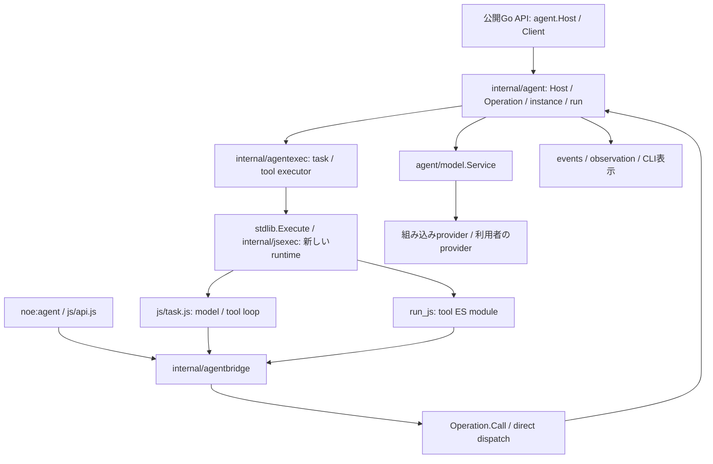

# Agent内部の構成

Agent機能を変更するときの入口。以下は開発版の `1bad24a`（2026-10-24照合）の構成を説明する。公開APIは[APIリファレンス](../api.md)を参照する。[配置整理の計画](agent-refactor-plan.md)と[実装記録](agent-refactor-implementation.md)は当時の構成・検証を残した過去記録であり、現行の実行方式や配置の正本ではない。

## JSとGoの分担

`noe:agent`の公開ESMは`internal/agent/js/agent.js`。公開APIの引数検証・設定継承とnative request呼出しは`js/api.js`、一つのtaskでモデル要求とtoolを繰り返すloopは`js/task.js`、会話の完全blockとtrim適用は`js/history.js`、hookの呼出しは`js/hooks.js`が担当する。

公開Go APIの`agent.Host`はモデルサービスと実行用profileを受け取り、agent管理層とexecutorを組み立てる。`agent.Client`は一つの所有scopeであり、`agent.Attach`は既存runtimeに新しいClientを接続する。Goからの型付き操作とJSからのJSON要求は、同じ管理層の受付・所有確認・取消し規則を通る。JSの要求は`internal/agentbridge`から`Operation.Call`へ渡し、`internal/agent/direct.go`で同一プロセス内の操作へ振り分ける。

`internal/agent`は所有関係、instance/taskの生存期間、共有状態、実行上限、モデル接続、会話snapshotの確定、画像bytesを管理する。`internal/agentexec`はtask／toolごとに`stdlib.Execute`で新しいruntimeを作る。`stdlib`は公開の汎用JS実行API、`internal/jsexec`はそのmanaged runtime・実行結果・診断を実装する。

Promiseの解決はruntime所有のevent loopへ戻す。Go workerには要求文字列やGoデータを渡し、QuickJS値の操作・評価・loop駆動・runtimeのCloseは所有goroutineで行う。

図のtaskとtoolは同一プロセス内の別runtimeで実行する。agent要求を運ぶHTTP brokerや、taskごとの別NOEプロセスは使わない。モデルサービスから外部providerへの通信と、人間用CLIのcontrol通信は、この内部要求経路とは別である。

## Go側の責務

以下のpathはリポジトリルート相対。

| 変更したい内容 | 主な場所 |
| --- | --- |
| 公開Go API・Host/Client・runtimeへの接続 | `agent/agent.go`、`agent/host.go`、`internal/agentbridge/bridge.go`。CLI側の組立は`internal/runtime/managed.go` |
| 公開モデルサービス・providerの差し替え | `agent/model/service.go`、`internal/agent/direct_model.go` |
| 設定JSONの省略/null・継承、task設定 | `internal/agent/config.go`、`internal/agent/task_config.go`、`internal/agent/js/api.js` |
| ホスト全体の初期化・終了 | `internal/agent/host.go` |
| 一つのClient／評価／子scopeの取消しとrequestの回収 | `internal/agent/operation.go`、`internal/agent/operation_request.go` |
| JSON要求と型付きGo操作の受付・振分け | `internal/agent/direct.go`、`internal/agent/typed_direct.go` |
| instanceの起動・観察・queue受付、要求/応答型 | `internal/agent/instance_operations.go`、`internal/agent/lifecycle_types.go` |
| instance状態・queue処理、taskの実行と終了報告 | `internal/agent/instance.go`、`internal/agent/task.go`、`internal/agent/task_wait.go` |
| 操作可能なowner/親子関係 | `internal/agent/ownership.go` |
| steer・interrupt・task取消し | `internal/agent/steer.go`、`internal/agent/interrupt.go`、`internal/agent/cancel_task.go` |
| 人間用CLIの接続先探索と通信 | `internal/app/control/`、`internal/cli/agent_control.go` |
| モデル要求、model step、tool結果の確定 | `internal/agent/broker_model.go`、`internal/agent/broker_model_step.go`、`internal/agent/broker_tool_result.go` |
| コンテキスト概算・予算・trim計画 | `internal/agent/context.go`、`internal/agent/context_history.go`、`internal/agent/context_policy.go`、`internal/agent/broker_context.go` |
| instanceに継続する会話snapshot | `internal/agent/conversation.go`、`internal/agent/js/history.js` |
| 画像のtool/run/会話への所有移管 | `internal/agent/images.go`、`internal/agent/images_context.go`、`internal/agent/images_direct.go`。codecと出力保存は`internal/image/` |
| hookのscope・module解決・呼出し結果 | `internal/agent/broker_hooks.go`、`internal/agent/hooks_direct.go`、`internal/agent/js/hooks.js` |
| root実行groupの計数・上限と因果関係 | `internal/agent/execution.go` |
| provider固有のwire形式・設定・catalog | `internal/agent/provider/` |
| run_jsの子scope・実行要求 | `internal/agent/broker_tools.go`、`internal/agent/executor.go` |
| task/toolのソース準備・bridge接続・stdout/stderr回収 | `internal/agentexec/executor.go`、`internal/agentexec/output.go` |
| 汎用runtimeの作成・実行・終了、dataと診断 | `stdlib/profile.go`、`internal/jsexec/profile.go`、`internal/jsexec/runtime.go`、`internal/jsexec/diagnostic.go` |
| モデル向けtool結果の出力予算・省略表示 | `internal/agent/tool_output.go` |
| 通知の共通metadataとtrace | `internal/agent/events.go`、`internal/agent/broker_events.go`。保存/整形は`internal/events/`・`internal/observation/`・CLI |

`broker_*.go`というファイル名は残るが、そこにあるモデル・tool・会話・hook等の処理はdirect dispatchから呼ぶGoの管理処理であり、内部HTTPサーバーの入口を意味しない。

## 実行経路

1. **組立と接続。** Go利用者は`agent.NewHost`に`model.Service`と、task/toolを実行する場合は`stdlib.Profile`を渡す。`NewClient`で所有scopeを作り、または`agent.Attach`で既存のnon-Worker runtimeへ接続する。CLIは`internal/runtime/managed.go`でprofile・models・Host・entry runtimeを組み立てる。
2. **agentの受付。** JSの`spawn_agent`やGoの`Client.Spawn`は所有scope内にinstanceと最初のcommandを作る。`queue_agent`／`Client.Queue`は同じinstanceへ次のcommandを追加する。受付とtask完了は別で、`wait_task`／`WaitTask`でcommandの結果を待つ。
3. **task loop。** `internal/agent/task.go`はtask用Operationを作り、executorへ実行を依頼する。`internal/agentexec`は`noe:agent/task`の`executeTask`を呼ぶES moduleを組み立て、`stdlib.Execute`で新しいruntimeを実行する。JS loopはモデル要求、tool実行、hook、履歴更新を進める。
4. **モデル接続。** loopの要求はbridgeとdirect dispatchを通り、model stepや実行上限を確認した後、Hostが借用する`model.Service`（`agent/model`）へ届く。`internal/agent/direct_model.go`が管理層のprovider境界へ適合させる。標準の`model.NewService`は`internal/agent/provider`の設定・wire実装を利用し、利用者のchat／decision／image実装も受け付ける。
5. **tool実行と回収。** `run_js`は所有runに結び付いた子Operationを作り、同じexecutorでtool ES moduleを別の新しいruntimeとして実行する。実行後は子scopeを閉じて所有する処理を回収してから結果を確定する。`data`・`diagnostics`はstdout/stderrと分けて返し、tool結果とhook処理を経て会話へ渡す。新runtimeなのでglobalとmodule cacheは実行ごとに新しくなるが、Hostの管理状態はGo側で共有する。
6. **会話と終了。** 完全blockのcheckpointや最終回答のcommitで会話snapshotを確定する。queueの次taskはinstanceの確定済みsnapshotを継承する。runtime終了時にはbindingと実行所有資源を回収し、command結果は所有scope内で観察・取得できる。

## 状態と同期の境界

- 内部の`Host`はOperation・instance・run・実行groupを管理する。`agentId`はinstance、`commandId`はspawn/queueで受け付けたtask、`runId`は実行中taskのrunを識別する。
- `Host.mu`がinstance/run/groupの共有状態を保護する。`*Locked`関数はこのmutexを保持した状態で呼ぶ。ファイルを分けてもmutexや所有関係は分割しない。
- 観察callbackを`Host.mu`保持中に呼ばない。状態更新後にunlockし、イベントを発行する。`accepted`・`settled`等のchannelは、受付・適用・終了イベントの順を保証するためのものなので、通知の直前/直後へ安易に移さない。
- Client／Operationの終了は新規requestを閉じ、進行中のrequest、所有するagent・run・子scopeを取消して回収する。短いrequest contextによる待機の取消しは、所有するtask自体の取消しではない。`cancel_task`は一つのcommand、`stop_agent`はinstanceと残りの仕事を止める。
- 所有確認はIDを知っているかではなくowner/親子関係に従う。task内toolから起動した子も所有元runに結び付く。`keepAlive`はその所有scopeを越えて子を存続させる権限ではない。Hostのtrusted Go管理操作と、JSに渡すClientのscopeを混同しない。
- `agent.Attach`はHost・runtime・loopを借用する。bindingのCloseは自身のClientとGo側処理を閉じるが、借用したHostやruntimeを閉じない。runtime全体を所有する`stdlib.Execute`／`NewRuntime`の終了責務とは区別する。取消し後の回収には、利用者のproviderやHTTP clientもcontextを尊重する必要がある。
- queueへ引き継ぐのは確定済み会話snapshotであり、途中の不完全なtool交換ではない。完全blockと必要な画像の所有を一緒に扱う。

## 出力回収と公開版との差

`internal/agentexec/output.go`はstdout/stderrをそれぞれ先頭・末尾32 KiBずつ保持し、省略量を返す。`internal/jsexec`はmoduleのdefault exportを`data`として直列化し、実行や直列化の失敗を診断へ分離する。直列化失敗後に副作用を再実行しない。

これとは別に、`internal/agent/tool_output.go`はhook後のモデル向けtool結果全体にUTF-8 byte予算を適用し、超過分を省略表示する。照合対象の開発版では既定値は**10 KiB**。公開済みv2.4.0で導入された**3 KiB**というリリース説明とは時点が異なる。ストリーム保持上限とモデル向け結果の予算を同じ制限として扱わない。

## 変更に応じて確認する試験

- Host/Clientの公開契約は`agent/host_test.go`、`agent/typed_client_test.go`。所有scope・取消し・待機は`internal/agent/client_close_test.go`、`internal/agent/cancel_task_test.go`、`internal/agent/task_wait_direct_test.go`等を参照する。
- task/tool実行と次のモデル要求へのdata・診断の引継ぎは`internal/agentexec/executor_test.go`、汎用runtimeの結果・直列化は`internal/jsexec/runtime_result_test.go`を参照する。
- モデル向け予算は`internal/agent/tool_output_test.go`、model/hook/JSONLへの省略情報の引継ぎは`tests/agent_output_e2e_test.go`を参照する。
- JSとGoをまたぐCLI側の挙動は`internal/runtime/`、実CLI・外部プロセス・PTY・保存JSONLは`tests/`のE2E、providerのwire変換は`internal/agent/provider/`のlocal fixtureを参照する。

変更した製品動作と影響経路に対応する確認を選ぶ。並行処理に触れた場合は該当scopeの取消し・イベント順・必要なrace検査を行う。文書のみの更新では参照pathと重要契約の照合を中心とし、過去の全体試験を一律に再実行しない。
