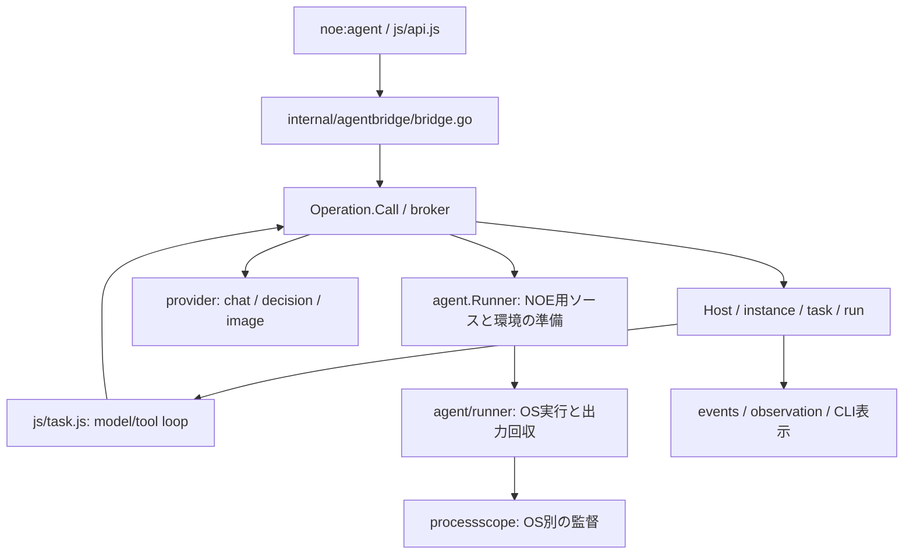

# Agent内部の構成

Agent機能を変更するときの入口。公開APIは[APIリファレンス](../api.md)、今回の配置整理は[計画](agent-refactor-plan.md)と[実装記録](agent-refactor-implementation.md)を参照する。

## JSとGoの分担

`noe:agent`の公開ESMは`internal/agent/js/agent.js`。公開APIの引数検証・設定継承とRPC呼出しは`js/api.js`、一つのtaskでモデル要求とtoolを繰り返すloopは`js/task.js`、会話の完全blockとtrim適用は`js/history.js`、hookの呼出しは`js/hooks.js`が担当する。

Go側はモデル/プロバイダへの接続、所有関係、instance/taskの生存期間、共有状態、実行上限、会話snapshotの確定、画像bytesを管理する。公開Go入口は`agent/agent.go`、QuickJSとGo側の管理層を接続する共通bridgeは`internal/agentbridge/bridge.go`にある。CLI側の`internal/runtime/runtime.go`もこのbridgeを利用する。Promiseの解決はruntime所有のevent loopへ戻す。agent packageのworker goroutineへQuickJS値を渡さない。

## Go側の責務

| 変更したい内容 | 主な場所 |
| --- | --- |
| 公開Go API・runtimeとの接続 | `agent/agent.go`、`internal/agentbridge/bridge.go`。CLI側の組立は`internal/runtime/runtime.go` |
| 設定JSONの省略/null、子への接続情報 | `internal/agent/config.go`、`connection.go` |
| ホスト全体の初期化・終了 | `internal/agent/host.go` |
| 一つの評価/子scopeの取消しとrequestの回収 | `internal/agent/operation.go` |
| HTTP受付・認証・RPC振分け | `internal/agent/broker.go`、`broker_rpc.go`、`broker_*.go` |
| instanceの起動・観察・queue受付 | `internal/agent/instance_operations.go`。HTTP入口は`broker_lifecycle.go`、要求/応答は`lifecycle_types.go` |
| instance状態と実行loop、taskプロセス起動 | `internal/agent/instance.go`、`task.go`。設定JSONは`task_config.go` |
| 操作可能なowner/親子関係 | `internal/agent/ownership.go` |
| steer・interruptの状態操作 | `internal/agent/steer.go`、`interrupt.go`。HTTP入口は`broker_steer.go`、`broker_interrupt.go` |
| 人間用CLIの接続先探索と通信 | `internal/agent/control_client.go`、`control_server.go`、`internal/cli/agent_control.go` |
| モデル要求、model step、tool結果の確定 | `internal/agent/broker_model*.go`、`broker_tool_result.go` |
| コンテキスト概算・予算・trim計画 | `internal/agent/context*.go`、`broker_context.go` |
| instanceに継続する会話snapshot | `internal/agent/conversation.go`、`js/history.js` |
| 画像のtool/run/会話への所有移管 | `internal/agent/images*.go`。codecと出力保存は`internal/image` |
| hookのscopeと呼出し結果 | `internal/agent/broker_hooks.go`、`hooks.go`、`js/hooks.js` |
| root実行groupの計数・上限と因果関係 | `internal/agent/execution.go` |
| provider固有のSDK・wire形式・設定・catalog | `internal/agent/provider` |
| NOE固有の子ソース・bootstrap・環境変数 | `internal/agent/runner.go` |
| OSプロセスの起動・回収、stdout/stderr上限 | `internal/agent/runner` |
| 通知の共通metadataとtrace | `internal/agent/events.go`、`broker_events.go`。保存/整形は`internal/events`・`internal/observation`・CLI |

## 状態と同期の境界

- `Host`はOperation・instance・run・実行groupを管理する。`agentId`はinstance、`runId`はそのinstanceが処理する一つのtaskを識別する。
- `Host.mu`がinstance/run/groupの共有状態を保護する。`*Locked`関数はこのmutexを保持した状態で呼ぶ。ファイルを分けてもmutexや所有関係は分割しない。
- 観察callbackを`Host.mu`保持中に呼ばない。状態更新後にunlockし、イベントを発行する。`accepted`・`settled`等のchannelは、受付・適用・終了イベントの順を保証するためのものなので、通知の直前/直後へ安易に移さない。
- Operation終了は新規requestを閉じ、進行中の処理と所有する子を回収する。HTTP requestの切断とOperation/instance/runの取消しは別の境界である。
- taskごとに新しいNOEプロセスでJS loopを動かす。queueはinstanceの確定済み会話snapshotを継承する。途中のtool交換は確定せず、完全blockと必要な画像の所有を一緒に扱う。
- `internal/agent/runner`は渡された環境だけでプロセスを起動する。agent用の環境変数除外やConnection生成は親packageの責務。OS実行層からHostやproviderへ依存しない。

この整理で全HTTP操作をservice化したわけではない。今回分離したのは外からinstance/taskを操作するspawn・observe/wait・queue・steer・interruptで、モデル要求・履歴確定・画像・hookのprivate RPC handlerは各`broker_*.go`や機能別ファイルに残る。これらも現行の共有状態・ロック規則に従う。

## 確認する試験

設定や状態遷移は`internal/agent`、JSとGoをまたぐ挙動は`internal/runtime`、実CLI・別プロセス・PTY・保存JSONLは`tests`のE2Eを参照する。出力収集の境界・UTF-8・保持量はrunnerのunit test、モデル/hook/JSONLへの省略情報の引継ぎは`tests/agent_output_e2e_test.go`が確認する。プロバイダのwire変換は`internal/agent/provider`のlocal fixtureで確認する。

通常の整理では既存試験で契約維持を確認し、移動した関数をなぞるだけの試験は増やさない。並行処理に触れた場合は該当scopeの取消し・イベント順・race検査を行う。
