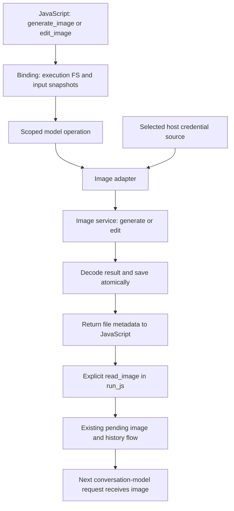

# Image generation and editing API extension

Status: implemented locally and independently reviewed, 2026-11-01.
See the [implementation record](image-api-extension-implementation.md) and
[verification results](image-api-extension-results.json). Native fresh-login live
confirmation was explicitly skipped by the user; managed refresh remains
fixture/race-verified rather than verified with a live owned grant.
The independent critical review is complete. This revision incorporates its
two P2 contract supplements: credential-generation-aware 401 recovery and
retention/accounting of known provider metadata when cancellation or errors occur.

This design follows the user-supplied `/tmp/noe-image-api-requirements.md`
and the authorized live subscription-route probe. It extends the current
[image APIs](../agent-images.md); it does not replace their existing contract.
The [earlier image plan](agent-images-plan.md) remains the historical record
for generation and vision. The new scope adds original-image editing and a
Codex-compatible ChatGPT image provider.

## Decisions

1. Keep `generate_image` and `read_image`; add `edit_image` with an ordered
   array of input image paths. Generation, editing, and vision are separate
   operations that JavaScript composes.
2. Add an image-only provider, `openai-codex-images`. Keep the current
   `openai-chatgpt` public plan-sharing provider and API-key providers intact.
3. Transfer image bytes, authenticate, refresh tokens, and save results in Go.
   JavaScript receives file metadata and structured errors.
4. Support a NOE-owned login with automatic refresh and an explicitly selected,
   read-only external Codex login. Never rotate an external application's
   refresh token or create a second active copy of its refresh grant.
5. Preserve the existing public Go `model.Service` interface. Editing is an
   optional additional interface, including through operation-scoped wrappers.
6. Implement the verified subscription route first. API-key editing, masks,
   multiple output images, progressive output, and application UI are later
   extensions, not prerequisites for this slice.



## Evidence and limits

Baseline: NOE v2.10.1, revision
`fedad4de3bd4e3d6c50412bf3621de0082b9d750`. Inspected Codex source is pinned to
`67f0994b532b8740f14b5b738af7b7b2a915b1d6` rather than a moving branch.
The durable [probe record](image-api-extension-evidence.json) records sources,
requests, output hashes, and the distinction between observed and untested behavior.

The user authorized use of the existing local Codex ChatGPT login for one
generation and one edit. A standalone probe called the service directly,
without invoking Codex. Generation produced a mint green square; editing sent
that actual PNG and produced an orange square. Both files were opened and
visually inspected. The approximate composition was retained; exact pixel
preservation was not established. This confirms access for this account and
environment, not a general third-party availability guarantee.

The probe used `gpt-image-2`, `n: 1`, `quality: low`, `background: opaque`, and
`size: 1024x1024`. Both returned files were actually **1254 by 1254**. Metadata
must come from decoding returned bytes; requested options are not guarantees.
PNG input/output is live-verified. JPEG/WebP input, multiple edit inputs,
transparent output, other options/models, refresh, and failure/cancellation
behavior still need their respective implementation checks.

The [public plan-sharing limitations](https://developers.openai.com/siwc/token-sharing-open-source/preview-limitations)
exclude hosted image generation tools. NOE also currently rejects
`chatgpt-oauth` image calls. Its token audience is the
[public API resource](https://developers.openai.com/siwc/token-sharing-open-source/token-reference).
Neither fact establishes that those tokens can authenticate to the separate
Codex backend. This design does not attempt that exchange.

## JavaScript contract

```js
import { generate_image, read_image } from "noe:image";

const original = await generate_image({
  provider: "openai-codex-images",
  model: "gpt-image-2",
  prompt: "A simple mint green robot face on white.",
  output: "images/robot.png",
  parameters: { quality: "low", background: "opaque" },
});
await read_image(original.path);
```

After that `run_js` finishes, the next conversation-model request receives
the image. A later tool execution can edit it using the user's feedback:

```js
import { edit_image, read_image } from "noe:image";

const revised = await edit_image({
  provider: "openai-codex-images",
  model: "gpt-image-2",
  images: ["images/robot.png"],
  prompt: "Make the eyes smaller. Keep the colors and outline.",
  output: "images/robot-v2.png",
});
await read_image(revised.path);
```

`edit_image` has the same required provider/model/prompt/output fields and
JSON `parameters` rules as generation, plus `images: readonly string[]`.
The array must contain at least one nonempty file path; its order is preserved.
Use one canonical array field rather than both `image` and `images` aliases.
The illustrative singular field in the requirements is superseded by this choice.

Paths resolve in the invoking execution's filesystem namespace and cwd.
Inputs are files read through that execution's filesystem, not remote URLs,
model history IDs, or caller-supplied data URLs. NOE reads and validates every
input before contacting the image service. The service receives the input
bytes, not the local filename. The input does not become a vision attachment
unless JavaScript separately calls `read_image`.

The result has the existing generation metadata shape:

```ts
interface ImageResult {
  path: string;
  mimeType: string;
  bytes: number;
  width: number;
  height: number;
  provider: string;
  model: string;
  responseModel?: string;
  requestId?: string;
  usage?: JSONValue;
}
```

One invocation produces one output file. `model` is the requested model;
`responseModel` is present only if supplied by the service. Results contain no
image bytes, data URLs, access tokens, or authorization headers. No `imageId`
is fabricated by generation/editing; the existing vision reader assigns it.

Callers create the output parent directory. Separate input/output paths retain
the original and revised files. Explicitly selecting an input as the output
keeps normal file-overwrite semantics: NOE snapshots the input first, and only
replaces the destination after a complete response has been validated.
Independent calls can run concurrently; callers coordinate shared destinations.

Generation/editing work in ordinary run/eval and agent `run_js`. They also work
in non-Worker public Go bindings with an enabled filesystem and model service.
The existing Worker boundary and `read_image`'s active-run_js requirement stay
in place. There is no automatic vision attachment, follow-up model request, or
provider/model inheritance.

## Provider configuration and dispatch

Proposed embedded provider definition:

```json
{
  "providers": {
    "openai-codex-images": {
      "sdk": "openai",
      "api": "images",
      "auth": "codex-oauth",
      "oauthMode": "managed",
      "oauthFile": "${configDir}/credentials/openai-codex-images.json",
      "oauthFileEnv": "NOE_CODEX_IMAGE_CREDENTIALS_FILE",
      "imageGeneration": {
        "baseURL": "https://chatgpt.com/backend-api/codex",
        "path": "/images/generations"
      },
      "imageEditing": {
        "baseURL": "https://chatgpt.com/backend-api/codex",
        "path": "/images/edits"
      },
      "models": {
        "gpt-image-2": {
          "catalog": {
            "kind": "image",
            "capabilities": { "imageGeneration": true, "imageEditing": true }
          }
        }
      }
    }
  }
}
```

The explicit external-login override sets `oauthMode: external-readonly` and
`oauthFile` to the selected Codex auth file. Credential precedence remains the
existing explicit Go credential mapping, supplied environment snapshot, then
provider file setting. Neither `NewService` nor `list_models` reads credentials
or contacts a service. A catalog entry describes an implemented operation;
it does not establish account entitlement.

Add `api: images`, `auth: codex-oauth`, `oauthMode`, and `imageEditing` to the
provider schema. Preserve existing `imageGeneration` JSON and model overlays.
Image-only definitions need image endpoint validation, not dummy chat endpoint
fields. `Generate`/`Decide` on them fail as unsupported before network access.
Existing chat providers continue to require their existing endpoint fields.

Refactor configuration resolution out of chat-client construction:

```text
provider ID + model overlay
  -> immutable resolved definition and credential location
  -> requested operation's adapter
```

Both image operations use this resolution directly. They must not construct a
chat client merely to retrieve its definition, as current generation dispatch
does. Preserve merged-profile client reuse, the borrowed HTTP client, and
host-controlled endpoint overrides. No credential, account, endpoint, or header
selection is added to the per-call JS `parameters` object.

The new adapter sends the verified JSON protocol through the borrowed Go HTTP
client. The public OpenAI SDK's multipart edit request is not substituted for
Codex's JSON request. Existing API-key generation adapters continue to use their
current SDK paths. API-key/OpenRouter editing remains unsupported until added
with provider-specific evidence; there is no fallback between routes.

## Authentication and ownership

Use a separate `credentials.CodexImages` source rather than changing the current
`credentials.ChatGPT` plan-sharing source or its record format.

| Mode | Token source | Update owner | Expiry behavior |
| --- | --- | --- | --- |
| `managed` | NOE-owned credential record from a dedicated login | NOE | Refresh before use and persist rotation |
| `external-readonly` | Explicitly selected Codex auth file | Codex/operator | Reload current tokens; expired credentials require renewal by their owner |

The managed record includes a schema version, credential kind, trusted issuer
and OAuth client provenance, account identity, tokens, and expiry. It is stored
privately outside the workspace's model-visible outputs. Token claims do not
select a token endpoint or establish a different account authority. Use the
validated login result to bind the account and account-routing header.

Provide a NOE-native login helper, `scripts/auth-codex-images.js`, backed by Go
operations in `noe:auth`. Proposed helper primitives are
`begin_codex_image_login({file})`, returning an attempt ID and authorization URL,
and `complete_codex_image_login(attemptId)`, returning public account metadata
after the loopback callback completes. Go owns the callback listener, state,
PKCE verifier, token exchange, validation, and credential persistence. Attempt
IDs are scoped to that execution and canceled on its shutdown. For a remote
NOE host, forward the selected loopback callback port through the user's SSH
connection; document its redirect requirements instead of assuming the
desktop browser can reach the remote host's loopback address. Refresh tokens
and access tokens never become helper return values or model input.

Use a Codex-compatible OAuth client profile pinned to the inspected source,
with host-configurable issuer/client ID and supported loopback redirect.
Use NOE's own originator/User-Agent. A public Codex client ID is not a claim
that NOE has a separately registered OAuth application. **A fresh login through
this helper and a subsequent managed refresh must be verified before managed
authentication is declared available.** The existing successful-token probe
does not establish those two operations. Do this in the first implementation
slice; do not defer authentication usability until release preparation.

The helper creates a dedicated grant. It does not copy the refresh token from
the user's active Codex session. A future explicit ownership transfer is not
required for this feature. If dedicated login is unavailable, report the
specific failure and retain read-only external-token mode as a clearly limited
option; do not claim automatic renewal or switch to API-key billing.

For managed refresh, reuse NOE's cross-process file lock and atomic private
write utilities. Inside the lock, reread the latest record, verify its account
binding, check expiry with the current 30-second margin, refresh if necessary,
and atomically save the rotated record before using it. Follow the pinned
Codex JSON refresh protocol without injecting NOE's plan-sharing resource or
scope. Preserve a valid existing refresh token if the service supplies only
new access credentials. Rejected/revoked grants produce an authentication
error requiring a new login; they do not start an interactive login themselves.

An external file is read without creating lock files or modifying its schema.
Accept a coherent selected ChatGPT token record with an account ID; reject
API-key records as an authentication mismatch. Parse expiry for freshness,
not as independent proof of identity. Read again on a later call so the owner's
rotation can take effect. Bind an in-flight request to one token/account snapshot.

401 recovery is separate from the ordinary expiry check. Each outbound image
request retains a private immutable credential snapshot, including its account
binding and credential generation/version. This snapshot is never serialized
into JavaScript results or observations. Pass the rejected snapshot to recovery
rather than calling the expiry-driven token getter again without that context.

For managed mode, recover an explicit HTTP 401 under the same credential-file
lock used for ordinary refresh:

1. Reread the current record and check it against the rejected snapshot's
   identity binding. If the account or trusted OAuth identity has changed,
   return an authentication error; do not retry using a different identity.
2. If another caller has already installed a newer same-identity credential,
   reuse that credential if it is still usable. Apply the normal expiry policy
   if the newer credential itself needs renewal; do not force another rotation
   merely because the older generation received a late 401.
3. If the rejected generation is still current, force one refresh even when
   its local expiry is in the future. Persist successful rotation atomically
   before returning the new snapshot. Concurrent 401 recoveries for the old
   generation then observe and reuse the recovered credential instead of
   rotating it again.
4. Retry the image request at most once, and only with a different usable
   access credential for the same identity. A repeated 401, failed refresh, or
   unchanged rejected credential ends recovery with an authentication error.

External-readonly mode may reread and retry once only if its owner has already
supplied a different usable token for the same identity. It never performs a
refresh or modifies the external file. Both modes retain the existing logical
image-operation identity across their single retry.

Do not automatically replay after an ambiguous timeout, transport failure,
5xx response, quota error, or content refusal. Such replay could create another
image and consume more quota.

## HTTP and image data

The [pinned image client](https://github.com/openai/codex/blob/67f0994b532b8740f14b5b738af7b7b2a915b1d6/codex-rs/codex-api/src/endpoint/images.rs)
posts JSON to the configured generation or edit path. Edits include:

```json
{
  "model": "gpt-image-2",
  "prompt": "Change the square to orange.",
  "n": 1,
  "images": [{"image_url": "data:image/png;base64,<host-encoded-image>"}]
}
```

Go decodes each input with the existing PNG/JPEG/WebP codec and uses its actual
MIME type. It preserves input bytes, image order, dimensions, and transparency;
there is no silent resizing, transcoding, or JPEG flattening. Publish JPEG/WebP
service support only after confirming it; the NOE codec's support alone is not
service evidence. Service rejection is surfaced rather than replaced by a
different operation or model.

The inspected Codex tool imposes a five-reference client limit, while its
request schema uses an array. Five is not established as a backend limit, so
do not install it as a universal NOE restriction. Validate actual provider limits
and record verified input counts/formats. One image is the current live baseline.

Keep model, prompt, input images, output count, streaming mode, transport, and
authentication host-owned, including against provider-default/model-overlay
parameters. Reject attempts to inject these through `parameters`. `mask` has no
first-slice edit contract: an unknown top-level `mask` field is an input error,
and an edit `parameters.mask` is unsupported at the input stage. Neither is
forwarded as an unverified feature. Other provider options remain
provider-specific JSON; document what was actually checked rather than invent
cross-provider option guarantees.

Attach the selected bearer token and `ChatGPT-Account-ID` in Go. Generate an
image turn ID per logical operation, reused for its single auth-recovery retry.
Use NOE's honest originator and User-Agent, as in the successful probe. NOE
does not require a fake Codex UI conversation or fabricate Codex turn metadata.
Apply auth headers after configured ordinary headers; keep them host-owned.
Follow the existing HTTP transport/proxy/CA policy, and do not forward credential
headers to a different authority through an image-service redirect. The built-in
HTTP client enforces this for both the bearer and account-routing headers;
embedding hosts supplying their own HTTP client own its redirect behavior and
must uphold the same credential boundary.

Require a complete decodable single-image response before saving. Treat an
empty, malformed, or unexpectedly multiple-image response as a response error
rather than silently selecting one result. Read actual MIME, dimensions and
byte count with `imageapi.ReadData`. Reuse `WriteFileAtomic` for saving and its
existing destination semantics. An input, response, write, or pre-commit
cancellation failure leaves the prior destination intact. Cancellation arriving
after the atomic rename does not roll back a committed file.

Retain sanitized response usage and request IDs when present. Prefer the
Codex image request ID header for the new adapter, with the ordinary request ID
as fallback. Preserve missing usage/model values as missing; do not invent token
counts or infer exact subscription consumption. The initial probe did not
collect these fields, so adapter fixtures and implementation evidence must.

## Go API and execution lifecycle

Add public `model.ImageInput` and `model.ImageEditRequest` types. Inputs contain
validated/snapshotted MIME and bytes, not paths that a provider adapter would
open. Edit requests carry provider, model, prompt, ordered inputs, parameters,
and the existing internal run identity; output location belongs to the binding.
Return the existing `model.GeneratedImage` byte/result type.

```go
type ImageEditor interface {
    EditImage(context.Context, ImageEditRequest) (GeneratedImage, error)
}
```

Add `Options.ImageEditor` and implement the optional interface on the built-in
service. Keep `model.Service`, `ImageProvider`, `ImageRequest`, and existing
required methods unchanged. Go callers can type-assert `model.ImageEditor`.
No existing custom chat or generation service gains a required editing method.

Editing dispatch order is explicit: `Options.ImageEditor`, then the selected
custom `ImageProvider` if it also implements `ImageEditor`, then the selected
custom chat `Provider` if no explicit image provider owns the operation, then
the built-in registry if neither custom provider claims it. A selected custom
provider that lacks editing returns `ErrUnsupported` and a structured image
error rather than falling back to a built-in account. Update `HasProvider`'s
independent-operation handling for an explicitly supplied editor.

The binding validates output write access and snapshots all input files using
its existing filesystem. A standalone Go editor accepts byte inputs and
validates their image content without depending on a JS runtime or filesystem.
Caller-owned Go byte slices must not be mutated during submission; the service
retains independent snapshots for the request lifetime.

The optional editing interface must survive `Operation.Models()`,
`operationModels`, the closed-operation wrapper, and `directModelProvider`.
Do not expose the borrowed underlying service to bypass operation ownership.
Use existing checked contexts and execution admission, provider validation,
providerCalls/imageProviderCalls accounting, and usage aggregation for both
operations. One logical generation/edit counts once, including auth recovery;
its HTTP attempt count may be recorded separately. Authentication refresh
does not itself count as an image generation.

Finalize known provider consumption before applying cancellation precedence
to the returned outcome. If a response provides usage/request identity and
cancellation arrives before the wrapper returns, aggregate the sanitized known
usage once and preserve the request ID, then return a cancelled ImageError.
The same metadata rule applies when a provider or response-decode error
accompanies known usage. An adapter must retain available metadata independently
of image decoding and must not discard it merely because the context ended.

Deduplicate accounting for the same provider response across result/error
carriers and later save observations; do not add identical usage twice.
Use the admitted logical operation and its local attempt identity for this
bookkeeping, since a provider request ID can be absent. Finalizing consumption
for already admitted work remains valid after cancellation or group closure;
it neither admits new work nor resumes the operation. Keep the captured
execution/run/tool ownership for its terminal observation. If no usage was
received, leave it unknown rather than manufacturing a zero or estimate.

Carry operation/run/host cancellation through input reads, refresh waits,
HTTP requests, decode checks, and save. Close cancels requests and joins
binding-owned work while leaving borrowed runtimes, services, and filesystems
open. Editing input snapshots are request-owned and released after completion;
`read_image` keeps its existing separate pending/history ownership.
Once cancellation is observed, do not start a subsequent save or commit a
pending replacement. The existing rule for a file already atomically committed
before cancellation still applies: it is not rolled back.

## Errors and observations

Preserve current `ImageError.code` categories: input, authentication, quota,
rate_limit, refusal, unsupported, transport, response, filesystem, cancelled.
Add optional `operation: generate | edit | read` and
`stage: input | authentication | request | response | save` fields so callers
can distinguish a failed edit request from a failed result save. Existing code
that checks only `code` keeps working. Read failures use operation `read` and
stage `input`; filesystem errors remain identifiable as such.

| Failure | Code / stage |
| --- | --- |
| Invalid options or invalid image content | input / input |
| Missing, unreadable, or out-of-root input file | filesystem / input |
| Missing local editing capability or an unimplemented mask option | unsupported / input |
| Missing/expired/revoked login or failed renewal | authentication / authentication |
| Quota exhaustion, including recognized image quota identifiers | quota / request |
| Temporary throttling | rate_limit / request |
| Content rejection or unsupported model/feature | refusal or unsupported / request |
| Network failure | transport / request |
| Empty or undecodable generated image | response / response |
| Output write failure | filesystem / save |
| Cancellation | cancelled / the active stage |

Do not infer all HTTP 429 responses to mean exhausted subscription quota.
Use known structured service codes/limit identifiers and preserve the sanitized
provider code, status, message, and request ID. Cancellation takes precedence
over incidental transport errors in the returned outcome, not over accounting
or retaining metadata already obtained. Preserve known sanitized usage and
request ID on cancelled, provider-error, response-error, and save-error outcomes.
Expose these in the structured ImageError and the terminal observation without
requiring a successful image result. Save observers report the metadata but do
not aggregate provider consumption a second time.

Reuse `image.started`, `image.completed`, `image.failed`, `image.cancelled`,
`image.saved`, and `image.save_failed`, adding the operation field rather than
creating an independent edit event family. Record input count and metadata,
output metadata, duration, usage and request identity as available. Maintain
the owning execution/model/tool IDs. The existing `image.read` event continues
to mean explicit vision attachment, not merely reading bytes for an edit.

Apply the existing sanitizer to both success metadata and all errors, extended
to the selected access, refresh and ID tokens. HTTP request/response bodies,
base64 images, account-routing headers, and authorization headers stay out of
model input and observations. Credential errors describe the actionable failure
without serializing the credential record or raw OAuth response.

## Implementation sequence and acceptance

| Slice | Change | Completion evidence |
| --- | --- | --- |
| 1. Credential lifecycle | Separate Codex credential source, native login helper, managed refresh, external-readonly mode | Deterministic expiry/rotation/locking/account/cancel fixtures, including unexpired-token 401 and concurrent recovery of one rejected generation; dedicated native sign-in and actual refresh verified separately from the prior probe |
| 2. Provider operations | Resolve definitions without chat-client construction; image-only configuration; generate/edit JSON adapter | Exact request/body/header fixtures, actual source bytes and input order, usage/request IDs, auth recovery, error classification; unchanged existing image generation |
| 3. Go and JS binding | Optional editor interfaces and dispatch, `edit_image`, shared filesystem/save path, structured errors | Custom-provider compatibility; rooted/readonly/input/output behavior; ordinary JS and public Go consumers; Worker boundary |
| 4. Agent lifecycle | Scoped editing, counters/usage, observations, explicit vision composition | Cancellation/close races, known usage/request identity retained on cancelled/error outcomes, execution limits, no duplicate counters or secret/image-body leaks, both images delivered at the correct later model steps |
| 5. Documentation and real workflow | Types, bundled module references, provider/auth/image guides, runnable examples | Actual JS generate -> read_image -> later edit -> read_image; model descriptions match inspected images; installed host/library use is documented |

Use this order for the main implementation dependencies. While a browser login
or another live check awaits the user, independent adapter/binding development
and fixture validation can continue. A pending live check prevents claiming
its capability complete; it does not block unrelated reversible work.

The two review corrections have deterministic acceptance cases:

- Credential recovery: a locally unexpired token receiving 401 forces renewal;
  two concurrent requests rejected on the same generation cause one successful
  recovery rotation and reuse its result. A late 401 reuses an already newer
  usable credential. An identity change prevents replay, a second 401 stops
  recovery, and external-readonly mode performs no credential writes or refresh.
- Cancellation/accounting: a fixture provider returns usage and a request ID
  while cancelling the context before the wrapper returns. The caller receives
  a cancelled ImageError containing that metadata, the owning execution records
  consumption once, its terminal observation retains request identity, and an
  existing destination remains unchanged. Also cover known usage accompanying
  provider/response errors, no duplicate aggregation through save failure, and
  missing usage remaining unknown.

Normal tests use loopback services and fixture credentials. Run focused race
checks for credential rotation and operation close/cancellation, not unrelated
long suites. Reuse the direct probe for its established transport facts, but
do not present it as native-login, refresh, JS binding, or agent vision evidence.
Use a clean external Go consumer to confirm the optional-interface contract
and published dependency closure during implementation.

Real authentication/service checks are separate, explicitly selected operations.
The existing authorization covered the completed two-request probe; this design
does not spend additional subscription quota or renew any real credential.
Record actual model/account-route support and options with each check. Any
unavailable live check remains an explicit acceptance gap. Do not label the
complete feature done based solely on fixture responses or returned image bytes.

Implementation documentation updates include `docs/agent-images.md`,
`docs/openai.md`, provider and embedding guides, `agent/types/noeagentlib.d.ts`,
bundled `noe:image`/`noe:model`/`noe:auth` references, and `examples/image/`.
Generation/vision history stays compatible. `noe:model` re-exports `edit_image`
alongside its existing generation export; no new conversation-model tool is added.

## Deferred scope

No noebot conversation IDs, retention rules, comparison UI, Telegram transport,
or mask editor enters NOE. Mask transport, API-key editing, more output images,
URL/file-ID input APIs, and streaming previews can be added using their own
verified provider contracts. Output files remain caller-owned. Broader service
availability/support promises and exact edit preservation are not inferred
from this account's successful two-request probe.

## Source map

| Existing source | Planned responsibility |
| --- | --- |
| `internal/credentials/`, `agent/auth/`, `scripts/auth-chatgpt.js` | Separate Codex source and native helper, reusing lock/private-write foundations |
| `internal/agent/provider/{config,catalog,image}.go`, `defaults.json` | Pure definition resolution, operation capability selection and separate Codex adapter |
| `internal/image/{image,codec}.go`, `internal/image/js/image.js` | Edit types/validation, metadata, JS contract |
| `agent/model/{model,service,binding}.go` | Optional editor interface, custom-provider dispatch and standalone use |
| `internal/modelbinding/binding.go` | Read input snapshots and save through the execution's actual FS |
| `internal/agent/{models,direct_model,images_direct}.go` | Scoped lifecycle, counters, usage, save observations and existing vision attachment |

Protocol references are the pinned Codex
[request schemas](https://github.com/openai/codex/blob/67f0994b532b8740f14b5b738af7b7b2a915b1d6/codex-rs/codex-api/src/images.rs),
[backend](https://github.com/openai/codex/blob/67f0994b532b8740f14b5b738af7b7b2a915b1d6/codex-rs/ext/image-generation/src/backend.rs),
[bearer authentication](https://github.com/openai/codex/blob/67f0994b532b8740f14b5b738af7b7b2a915b1d6/codex-rs/model-provider/src/bearer_auth_provider.rs),
[OAuth transport](https://github.com/openai/codex/blob/67f0994b532b8740f14b5b738af7b7b2a915b1d6/codex-rs/login/src/oauth/client.rs),
and [login flow](https://github.com/openai/codex/blob/67f0994b532b8740f14b5b738af7b7b2a915b1d6/codex-rs/login/src/server.rs).
The [official image guide](https://learn.chatgpt.com/docs/image-generation)
documents Codex image usage against included limits; exact quota consumption
is service-reported, not calculated from image size by NOE.
