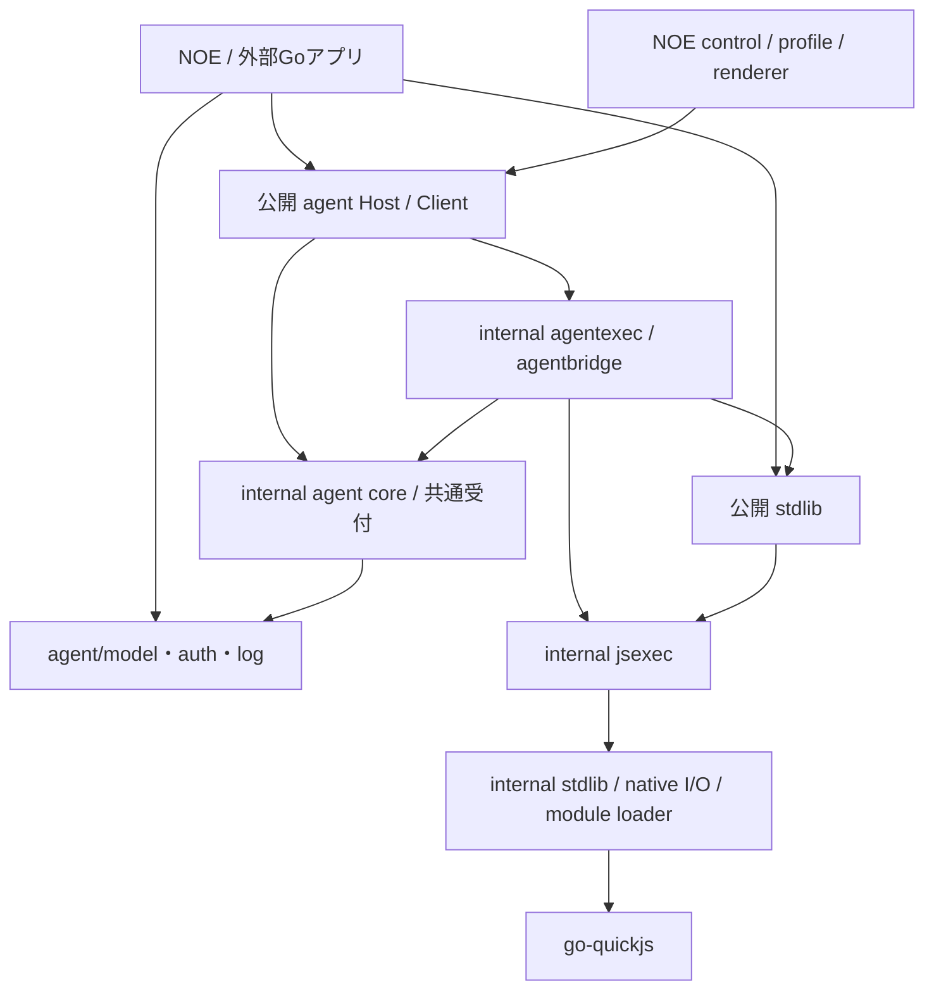

# v2：API再設計・agentアプリ内実行の実装計画

[改訂レビュー記録](v2-api-redesign-review.md)。計画段階で停止し、製品実装・動作検証は未実施。

2026-10-21。基点ソース：`c1006f1c1604194aaa9ca61bdb07aed2666702b5`。状態：改訂・通常/批判的レビュー・指摘反映・限定再確認を完了。残る必須指摘なし。

利用者はAPI全体に広げた分離案を受け入れ、計画の見直しを依頼した。本改訂は旧計画の「現行JS API維持」「8スライス」「内部RPC再利用」を置き換える。[API再設計](v2-api-redesign.md)に機能と移行契約、[責務・経路台帳](v2-responsibility-boundaries.md)に所属/設定元/所有/入口を定める。以前の通常/批判的レビューの合格は過去snapshotの判定であり、本改訂へ流用しない。

今回の範囲は計画作成、通常/批判的レビュー、採否・修正・必要な限定再確認、記録後の停止。製品実装、test/build、実provider、commit/push/releaseは行わない。

## 1. 完了条件

- 外部GoアプリがNOE binaryと入口用JS runtimeなしで、Go Host/Clientからagentの起動・queue・結果・取消しを使える。task/run_js自体のJS実行はstdlibで行う。
- 別Go moduleのconsumerでstdlib単体、model/auth/log単独、agent＋stdlibが成立する。NOE既定の場所・方針・controlを自動導入しない。
- noeはCLI/表示/保存/defaults/control adapter、noestdlibはJS実行/I/O/回収、noeagentlibはmodel/agent状態/会話/所有/イベント解釈を持つ。
- Host/Client/JS binding、model service、runtimeの寿命を分け、共有Host/serviceをbinding終了で閉じない。Go/JS/CLIの操作は共通受付を通る。
- 合意したsession/cache、委譲受付、queue会話、結果原文、hook因果関係、出力上限、OS回収、OAuth更新を保つ。破壊的API変更と実用上の機能喪失を区別する。

同一repository/Go moduleで開発し、stdlibのproduction import closureからagent/CLI/SDKへの逆依存をなくす。agent/model/auth/logからagent管理への依存、agentからNOE profile/controlへの依存も作らない。engine/SDK更新・独立release・Worker agent・会話永続化・detached agent・v2公開は対象外。

## 2. 構成と実装上の境界

agent coreはJS値を保持しない。内部Executorはsource/origin・実行profile・scope付きClientを受け、stdout/stderr/exitCode/reason/省略byte数・準備errorをGo値で返す。task/tool種別は内部契約。public Executor frameworkは作らない。

internal/jsexecは公開stdlibをimportせず、下位実装とengineを使う。公開stdlibがこれを包む。agentexec/bridgeは共通実行とagent moduleを組み立てる。task/toolごとにfresh runtime/global/module cacheを持ち、queueではHostの会話とinstance設定だけを引き継ぐ。

現行broker handlerの実際の受付・状態更新をcore serviceへ取り出す。Go Client/JS adapter/NOE管理adapterは同じserviceを呼ぶ。内部HTTP request/responseやConnection JSONを新しい公開APIにせず、operationの取消しとscopeをGoで渡す。モデルSDKのHTTPとNOE人間向けcontrol HTTPは残る。

公開HostはGo状態を所有し、JSへのAttachは借用Hostから専用Clientを作る。task/toolのbindingにはrootの対応scopeへ束縛したClientを渡し、再びHost/registryを作らない。publicなClientにraw scope変更や全Host管理を渡さない。finish/final確定・画像添付・再委譲の検査は共通coreに残す。

### profileとI/O

Profile.Environmentを一つだけ持ち、個別APIのLoop/cwd/env/stdioを最終公開型から外す。既存内部型へ一時変換して段階導入してよいが、v2候補には二つの設定入口を残さない。新Modulesで選んだFS/Commands/各network/Signals/Stdioをroot/Worker/agent実行へ一貫して導入する。

managed Runtimeとadvanced Attachは同じBindings viewを返し、VM/Loop/Environment/context/当該FS/Worker情報をbindingへ明示供給する。agent.Attachはraw rt/loopでなくこのviewを受け、Hostのtemplate FSを代用しない。Profile.Initializeは各実行owner上で独立auth/log等を導入し、返されたcleanupをentry評価後・Bindings/VM終了前に回収する。NOEのinitializerはWorker情報で導入を分ける。名前/具体型はAPI再設計§2に従う。

Node FSとfs-handle、画像file helperは同じFS backend、Node commandとnoe:processは同じprocessscopeを使う。Rootありの仮想cwdと物理command cwd、ReadOnly、symlink、Windows path/volumeはAPI再設計の契約に従う。Rootを新しい全プロセスsandboxと扱わない。NOEは従来の通常OS機能を明示選択する。

root/子/Workerは同じLoaderFactory設定から実行別loaderを作る。factoryをowner上で呼び、共有元の並行安全性を要求する。生成sourceは仮想ID、relative importは実行cwdをbaseとする。旧private一時directory基準からの変更は移行説明とfixtureへ含める。

cwd基準は仮想entryだけに適用し、通常file/moduleはreferrer基準を維持する。hookはHost登録時にはspecifier/indexを固定し、OS pathへ正規化しない。taskのloader作成後に解決/読込みし、そのtaskのcanonical ID＋indexで同定する。解決/読込みerrorはmodel要求前のtask失敗へ移す。

## 3. 所有・取消し・終了

| 資源 | 所有者 | 終了契約 |
| --- | --- | --- |
| model service/HTTP client | 作成したhost。agent Hostからは借用 | agent Closeで共有clientを閉じない。要求は呼出しcontextに従う |
| agent Host | NOEまたは外部Goアプリ | 受付停止→全Client/instance/taskを取消し→owned実行をjoin |
| Go Client | 作成したcaller、またはJS binding | 自分のOperationと所有agentを取消し/join。別Clientに影響させない |
| JS binding | 当該runtimeの組立 | 自分のClient/hook scope/Go workerを回収。Host/rt/Loopは借用 |
| task/tool runtime/Loop | Executorのowner goroutine | context/開始gateを閉じ、評価/drive後にownerでClose |
| file/command/socket/Worker等 | 実行scope | ContextとLoop終了で停止し、Go処理/子孫/pipeをjoin |
| stdio adapter/capture | managed実行 | producer終了後に確定。元のstdioは借用 |
| instruction source/loader callback | hostから借用 | その実行contextに協調。隠れたgoroutineで放置しない |
| initializer/独立binding | 各実行が作成しcleanupを所有 | ownerで呼び、取消し/評価終了後に逆順回収。共有callback/service/元sinkは閉じない |
| control HTTP/登録file | NOE adapter | Hostの停止/アプリcontextで受付停止し、登録除去・server join |

fresh実行は、context/出力/開始gate→runtime/Loop→stdlib/Bindings→initializer→entry loader準備→scope付きbinding→評価の順。setup途中の失敗も作成済み資源を同じ手順で回収する。initializerはentryの先行実行をしない。評価前にcontext取消しをLoop.Closeへ接続し、CPU処理はEvalContextを使う。cancel goroutineからrt.Close/JS値/Promiseへ触れない。

終了は、(1)新規開始gateを閉じ実行contextを取消す、(2)Loopを止めIO/同期command/Workerへ通知、(3)評価/driveが戻る、(4)ownerがbindingとruntimeを閉じowned producerをjoin、(5)capture/Go診断を確定、(6)task/toolのcore scopeを解放して結果を確定。GoのCloseはLoop.PostのJS配送完了を待たない。

binding終了ではhook contextもworker joinより前に取消す。Hostを共有する別bindingは止めない。NOEが所有するHost全体を終了する場合は、entry contextとruntimeを取消し、binding/Hostのowned仕事をjoinし、ownerでruntimeを閉じ、最後にCLIが自分のevent fileをflush/closeする。

正常終了では必要なPromise/job/IOを既存drain方針で処理する。keepAlive idleとinstance停止は別。Executor正常終了だけでtaskをcommitせず、対応Clientのfinish・確定済み回答と照合する。取消しとの優先順位・回答保持は既存契約を回帰確認する。

### 同期stdioとcallback

stdioは評価/導入前にcontext-bound adapterへ正規化する。通常Readはhostio.ReadContext、通常WriteはSharedWriter.WriteContextへ結び、console/Process/native I/Oが同じsink adapterを共用する。ContextReader/Writerも実行contextと結合する。EOF以外のI/O errorを記録してdriveを止め、consoleが無視しても最終結果を成功にしない。親context終了を優先し、他のI/O errorは原因として保持する。

Host.Runtimeのtemplateではstdioをnilに予約し、非nilはNewHost時に設定errorとする。task/toolはそのProfileのコピーへ空stdin＋実行専用有界captureを束縛し、initializerのBindingsも派生後の出力に接続する。元Profileは変更しない。各stream先頭/末尾32KiBと省略通知を維持し、任意writerへのteeは追加しない。元のfile/reader/writerは閉じず、既存hostioのmemory/file/context-aware sourceを対応範囲とし、非対応はErrUnsupported。任意Go callbackの強制中断や、隠れたgoroutine放置による回避は約束しない。

### OS command

開始gate、context/timeout、並行pipe drain、scope Close/Waitを共通化する。POSIXではWaitExit/WNOWAITでleader PIDを保持し、group回収後にWaitする。WindowsはJob Object。直接方式はhost SIGKILL後の回収を保証せず、NOEの明示helperは現行のowner死亡時回収を維持する。library initでアプリを再実行/終了させない。self-helperのinit条件・別helper・引数dispatcherをGoガイドへ記す。

## 4. 維持する実用契約と破壊的変更

| 項目 | 維持/変更と受入 |
| --- | --- |
| 会話/session/cache | instance内のqueueでSessionID/system/tools固定。run IDはtaskごと。状態通知は履歴。provider別header/wire変換を回帰確認 |
| 委譲/group | 親→子、明示allowDelegation、自己許可/自動再継承なし、所有者終了時回収、共有group枠を維持。Go/JS/controlの共通受付で実施 |
| 結果 | commandId/反復wait/原文/UTF-8範囲/省略受取/失敗取消しを維持。task取消しとinstance停止のAPIを分割 |
| hook | before/after model/tool、引数/result/画像選択、因果関係、hook要求取消しと子のrun所有を維持。共通Clientへ接続 |
| instruction | sourceを初taskで呼びqueue固定、新子再読込。NOEは現行directory規則をadapterで維持 |
| ログ | JSはliveとdata解析へ分割。CLI操作と既存JSONL/cursorの解析を維持。file pollingはNOE/呼出し側 |
| 画像 | JSにはmetadataのみ、bytesはGo保持。file helperが共通FSへ従う。生成後の保存失敗/usage保持 |
| process/module | process.pidはhost PID、fresh stateを保証。sourceは仮想ID、relative import基準をcwdへ変更 |
| control/docs/auth | controlはNOEへ、初agent受付後にactivationし、登録失敗はNOE実行errorへ変更。docsは常時参照、auth helperは独立。NOEは機能を明示的に組み立てる |

公開API・JS module・型定義・examples・内蔵docsの変更を同じ候補へ揃え、旧aliasや旧JS process backendの自動fallbackを最終候補へ残さない。破壊的APIの具体対応はAPI再設計§6を参照する。

## 5. 実装スライス

全スライスは **実装→対象テスト→独立コードレビュー→指摘修正/対象再確認** を完了して次へ進む。対象試験は既存を実際の契約へ移し、新しい型や移動関数をなぞるだけの試験を増やさない。密接な作業は親が実装し、スライス数だけagentを起動しない。

| Slice・経路 | 実装/成果物 | 対象試験と終了条件 | 独立レビューの重点 |
| --- | --- | --- | --- |
| S1 model/auth分離 M1/M2 | SDK非依存domain型とagent/model service、registry/認証先の明示解決、独立auth helper/binding | 4組込みadapterのlocal HTTP fixture、custom provider/unsupported、catalog認証不要、path優先順位/遅延、OAuth同file更新、authだけでHost未生成 | agent/NOE逆依存、暗黙認証fallback、借用HTTP、単独とagent内のmodel差 |
| S2 Profile/Environment E1/E2 | 公開Profile/Modules/Environment、共通Bindings/実行FS view、owner initializer/cleanup、LoaderFactory/entry origin、内部変換 | 異なるcwd/envの並行実行、factory実行別、copy/borrow、Root仮想cwdと物理基準、個別Loop/stdio設定の廃止、Bindingsが実行FSを指すこと、initializerの実行別導入をconsumerで確認 | 設定の二重正本、ambient cwd/env、公開面、factory共有 |
| S3 FS/I/O共通基盤 F1/N1/P1/P2 | IO一括switch撤去、独立module選択、FS/fs-handle共通backend、Node/native commandのcwd/env/PATH resolver共用 | stdioのみでProcess/FS/socket/signal不要、FS nil/Root/ReadOnly/symlinkとhandle一致、Windows volume/PATHEXT/ComSpec、選択APIの独立性 | Root迂回、不要な一括権限、機能喪失、Node/Web Stream差の混同 |
| S4 command監督 P1/P2 | 全sync/async commandのprocessscope、直接/明示helper、main dispatcher、library init廃止 | 孫/pipe保持/cancel/timeout/owner close、code/error出力、直接consumer init一回、別helper/NOE helperのowner死亡、関連race | PID/handle寿命、start/cancel競合、NOE owner死亡時回収、helper配備条件 |
| S5 managed実行 E1/E2/D1 | internal/jsexec、NewRuntime/Execute/advanced Attachと共通Bindings、一つのLoop、initializer/失敗cleanup、context stdio、docs常時、fresh loader | 外部stdlib consumer、CPU/同期入出力取消し、満杯pipe/元sink継続使用、I/O error保持、Promise/exit/未捕捉、fresh module/global、initializer途中失敗の回収、独立bindingのCloseで元service未Close、Worker factory/initializer分岐/empty stdin | owner外JS、Close相互待ち、public/internal循環、結果/借用、managed/advancedの同一契約 |
| S6 Host/Clientと共通受付 A1/A2/C1 | Go Host/Client/管理入口、handlerからservice抽出、モデルscope wrapper、cancel_task/stop_agent。旧RPC adapterは比較用内部のみ | 入口JS runtimeなしのGo spawn/queue/wait/result/steer/cancel/stop、共有Hostの独立Client、委譲/group/usage、未開始task取消し、hook specifier/index登録と独自bare/memory解決、長要求待機と取消し | Client scope偽装/誤共有、Goだけの受付抜け、ID/queue/会話/結果の退行、borrowed service |
| S7 agentアプリ内実行 E2/A1/A2/I1/I2 | Executor/bridgeを直接Clientへ接続、task/tool fresh実行、hook共通Client、画像file helper/Go bytes経路 | local modelで親tool→子→queue、hook/並行tool、session履歴、finish/final/cancel、画像選択、異なるHost template/Attach先FSで実行FS設定到達、capture/空入力/元Profile非変更、auth/log initializerがroot/task/toolへ到達、hook canonical同定/queue再解決、atomic保存/usage、Hostなし単独画像生成 | root再生成/誤Close、二重model計上、無制限service露出、finish所有検証、画像bytesのJS混入 |
| S8 instruction/log A3/L1/L2 | InstructionSource、NOE directory source、agent/log data parserとJS binding、旧logPath観察の置換 | 初task/queue固定/新子再読込/並行source/error前provider未呼出し、Hostなしlog解析、cursor全履歴復元/不完全末尾/既存log fixture、hookから同じdata解析 | file/Hostへの逆依存、差分だけで状態喪失、source snapshot/cache、全文JS往復の説明 |
| S9 NOE組立/control C1/C2/V1 | noeprofile、NOE control server/discovery、Host Go管理、CLI run/eval/events/observe接続、env filter/helper/model/auth選択 | CLI全commands、observe follow/json/wait、Control遅延activation/ready/失敗時のNOE取消しと登録除去/別token/誤対象防止、public/private既定値重複なし、4キー変数/旧Connection非露出 | CLI権限をJSへ渡す混同、control初回error返却先の変更、activation/終了競合、既定場所、signal、event保存/表示、Host終了 |
| S10 API移行/consumer D1/全経路 | Go/JS型・examples・guide・apidocs本文/metadata/error、移行一覧、独立consumer fixturesを完成 | stdlib/model/auth/log/agent各consumer、NOE binary不要、独自path/OAuth/source/loader、画像/read-only、API/文書整合、通常CLI互換 | 旧API説明/alias残存、未使用設定、独立利用へのSDK/CLI依存、移行手順の欠落 |
| S11 旧経路撤去/候補固定 全経路 | 旧agent process backend/RPC/Connection/bootstrap/env、旧public設定と不要試験を撤去。台帳と差分照合 | 対象回帰、production import closure、旧プロトコル未到達、意味を持つ回収/session/所有試験の保全、リンク/型/整形。候補revision固定 | 動作の比較先消失による検査喪失、隠れfallback、dead code、旧仕様混在 |

順序はS1→S2→S3→S4→S5→S6→S7→S8→S9→S10→S11。新しいprofile/Go入口を先に導入し、NOEの既定経路切替は必要な機構が揃うS9で行う。移行比較の旧実装は内部だけで保持し、全テストを二方式で恒久的に倍増しない。公開APIの破壊的切替は各関連sliceで行い、旧型/呼出し元の一時互換adapterはS11までに除く。

各sliceの担当・変更file・経路ID・旧経路撤去・対象試験・reviewer・finding採否を実装記録へ残す。関連修正/再確認は同じ担当を再利用する。初回review30分、証拠更新10分なしなら暫定返却。必要な再確認は既存findingと変更箇所だけ1回15分以内。延長は並行処理等の具体的理由と上限を親が記録し、未解消の進行を妨げる指摘を残して次へ進まない。

## 6. 最後の総合テスト

S11の実装/対象試験/独立reviewを終えた候補で、親がまとめて一度行う。修正が入ればその影響の再確認を追加する。過去の内部HTTP方式だけを検査した試験は、所有・長待機・取消しの新経路へ置換し、削除理由と対応を記録する。

| 検証 | 範囲/目的 |
| --- | --- |
| 全unit | `CGO_ENABLED=0 go test ./... -count=1`。追加public packageを含む全体 |
| race | `CGO_ENABLED=1 go test -race ./internal/... ./stdlib/... ./agent/... -count=1`。共有Host/Client/loader/FS/終了 |
| E2E | `go test -tags=e2e ./... -count=1`。MCP bundle準備、CLI/Go/JS agent/I/O/取消し/JSONL |
| 長待機 | 既存long-RPC fixtureを直接Clientの長いprovider/tool待機と取消しへ移す。不要なHTTP timeout前提を残さない。実装で選んだtag/commandを記録 |
| vet/compile | E2Eタグ込みvet、CGO-free vet、Linux/macOS/Windows各amd64/arm64の6対象。配布/releaseはしない |
| 独立consumer | 別moduleでstdlibだけ、model/auth/log単独、Go Host/Clientだけの入口、JS agent、独自source/loader/認証先/Host共有/終了。local replacementで候補を使用 |
| 候補CLI | arithmetic・sync command失敗・親子/queue/session・結果範囲・hook・control・ログfollow/json/wait・event保存を候補binaryで確認 |
| 依存/撤去/文書 | go list production import closure、経路台帳、旧RPC/process/設定の未到達、API型/examples/apidocs/移行説明・相対リンクを照合 |

Linux native/raceを実行し、他OS/arm64のcompileをnative検証と混同しない。OS固有の変更は使える実機/CIで確認し、未実施を記録する。TMPDIR/GOTMPDIRは既存socket制約に合う短いpathを使い、test外のNOE_AGENT_CONNECTIONを分離する。

revision、各command、合否、初回失敗/原因、再確認、未実施範囲を実装記録へ保存する。性能改善やcache90%等を計測前の合格条件にしない。

## 7. 必要時の実provider

利用者は必要に応じた実providerを許可している。後続S10/総合でfixtureでは残る問いがある時だけ、問いとproviderを記録して使う。今回は接続しない。

最初はNOEの既存認証を使う1provider、短い親task/run_js/子1体/同一instance queue。groupのmodel要求16、instance root＋子2体を目安の停止上限とし、上限到達は成功にしない。別adapter/auth固有の問いがある場合だけ追加providerを選ぶ。cacheは親/子別の入力/cached合計と初回除外の率を観測し、指標改善のために反復しない。秘密本文は記録しない。

## 8. 今回の判定と停止

破壊的変更は設計/移行に許可されたものであり、製品実装やreleaseへの続行を意味しない。親が改訂計画の通常reviewと批判的reviewを受け、採否・修正・必要な限定再確認を記録して停止する。旧計画の合格判定を新計画の検証結果として転用しない。
