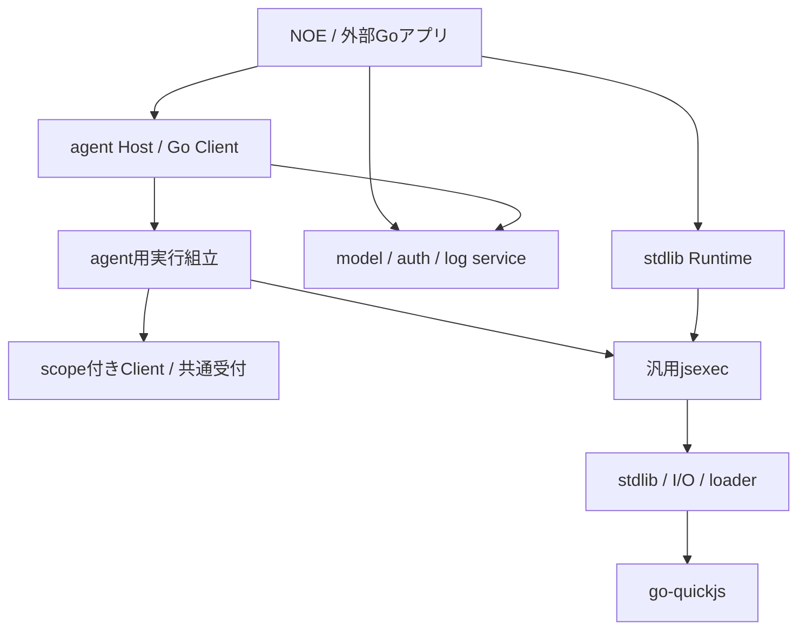

# v2構成案：NOE・stdlib・agentlibの分離（API再設計版）

[改訂レビュー記録](v2-api-redesign-review.md)。計画段階で停止し、製品実装・動作検証は未実施。

2026-10-21。基点：`c1006f1c1604194aaa9ca61bdb07aed2666702b5`。利用者の提案採用と破壊的変更許可に基づく改訂。状態：改訂・通常/批判的レビュー・指摘反映・限定再確認を完了。残る必須指摘なし。製品実装は未着手。

## 1. 目的と正本

外部Goアプリが別NOE binaryや入口用JS runtimeを用意せず、GoのHost/Clientからagentを使える構成にする。NOEも同じライブラリで動く。API互換性の維持より、責務・設定・所有・実行経路を明確にする変更を採用する。

| 正本 | 内容 |
| --- | --- |
| [API再設計](v2-api-redesign.md) | 提案の採否、公開面、破壊的変更、機能/移行契約 |
| [実装計画](v2-agent-runtime-implementation-plan.md) | 終了/取消し、11スライスの実装/テスト/独立レビュー、最後の総合テスト |
| [責務・経路台帳](v2-responsibility-boundaries.md) | 実体/設定元/資源所有、Go/JS/hook/CLIの現在入口と移行先 |

旧計画の「現行JS API維持」「8スライス」「内部HTTP RPCを再利用」は置き換える。以前の[構成案レビュー](v2-agent-runtime-review.md)・[実装計画レビュー](v2-agent-runtime-implementation-review.md)・[分離レビュー](v2-agent-runtime-separation-review.md)は記載した過去snapshotの記録であり、この改訂を検証済みとしない。

## 2. 三者の責務

| 層 | 持つもの | 持込まないもの |
| --- | --- | --- |
| noe | CLI、表示/保存、NOE既定値・場所・Policy、instruction directory source、control HTTP/発見file、ライブラリ組立 | 共通runtime/agent/model処理の別実装 |
| noestdlib | Profile/Environment、JS実行/Loop、loader、FS/command/network/stdio/Worker/資源回収、docs導入 | agent状態/SDK、NOE defaults/control |
| noeagentlib | model/認証機構、Host/Client、会話/session/親子/queue/group/hook/run_js/結果/event解釈、画像処理 | NOEのdirectory探索・control登録・ログfile polling |
| go-quickjs | JS言語処理/値/例外/Promise/job/engine中断 | NOE/provider設定・agent状態 |

noestdlibはagentlibを含む総称にしない。同一repository/Go module内で公開stdlib、agent、agent/model・auth・logを保守する。SDK非依存のモデル型を使い、stdlibからSDK/agentへの逆依存を作らない。別repo/module化と独立releaseは今回しない。

## 3. 構成の骨格

HostはJSに依存しないGo状態と所有を持ち、agent実行は必要時にstdlibのfresh runtimeを使う。JS bindingはHostを借りて自分のClientを所有する。Hostの別Clientをbinding終了で止めない。

GoとJSは同じscope付き受付を直接呼ぶ。内部HTTP broker/Connection/token/別NOE実行を撤去し、人間向けHTTP controlはNOE adapterへ分ける。通信を消すことと、所有/再委譲/finish/final/画像の受付検査を消すことを混同しない。

## 4. 機能の再配置

- EnvironmentとModulesへ実行設定を集約し、nested Loop/cwd/env/stdioとIO一括switchを外す。NodeとnativeのFS/command backendを共通化する。
- LoaderFactoryをroot/子/Workerで共用し、各実行のloader/cacheを分ける。Bindingsとowner initializerでその実行のFS/独立bindingを明示する。sourceは仮想ID、仮想entryのrelative importは実行cwd、file moduleはreferrerを基準とする。
- model/auth/logはHostなしで使える。agent内model要求は同じserviceへのscope wrapperで計上/取消し/権限を維持する。
- instructionは本文供給関数とし、初task固定/queue継続/新子で再呼出し。NOEのdirectory規則と運用方針はadapter/Policyへ置く。
- observe_agentはlive観察専用、保存ログは入力data解析へ分ける。CLI observeのfile/追記待機はNOEが担う。
- docsは常時参照可能。画像file helperは実行FSを借用し、bytesのGo保持とmetadata-only JSを維持する。
- task取消しとinstance停止のAPIを分け、agentId/commandId/runIdの役割、結果原文/範囲取得、会話/session、委譲と所有を維持する。

## 5. 実装・レビュー・停止

実装計画の11スライスそれぞれで実装→対象テスト→独立コードレビュー→修正/限定再確認を行い、最後に候補全体の総合テストを行う。単純な検査はscript、密接な作業は親が行い、工程数だけ子を起動しない。必要時の実provider利用は後続検証に許可されているが、計画段階では使わない。

今回の依頼はこの改訂の計画と通常/批判的レビュー、結果反映後の停止まで。製品実装、test/build、commit/push/release、v2公開へは続行しない。API移行済み・動作成功・性能改善の判定は実装後の受入で行う。
